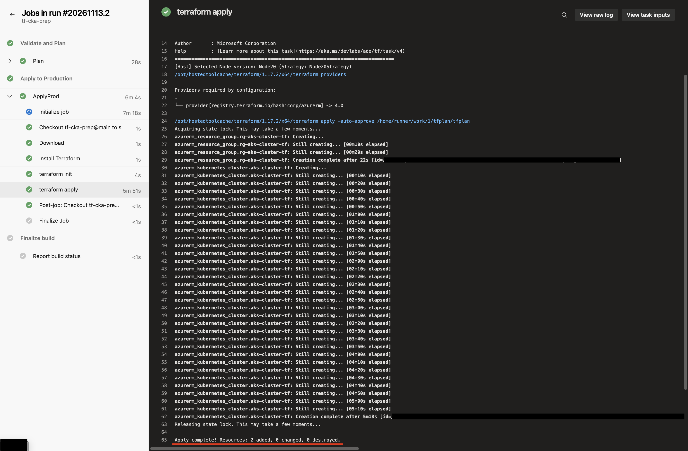

# tf-cka-prep

This repository is a public clone of a private Azure DevOps repository. All changes in the ADO repo will be reflected here.

Terraform and an Azure DevOps pipeline that create and destroy a small, low-cost AKS cluster for Kubernetes (CKA) practice.

Every change goes through **plan → manual approval → apply**. The same pipeline can tear everything down, so the cluster only runs while you're studying.

## Pipeline run

<!-- Screenshot: save the image as docs/pipeline-run.png, then delete this comment. -->


A run on `main`: the plan stage passes, the apply stage waits for approval, then Terraform creates the resource group and the AKS cluster.

## Scope and limits

Most exam topics can be practiced in this sandbox: troubleshooting workloads, scheduling, services and networking, storage, and RBAC.

Tasks that need access to the control plane cannot, because AKS manages it. That covers installing and upgrading clusters with kubeadm, etcd backup and restore, and control-plane troubleshooting.

In the future, another pipeline will be created to deploy four VMs to practice installing, updating, and managing Kubernetes with kubeadm.

## What it deploys

| Resource | Details |
|---|---|
| Resource group | `rg-aks-cluster-tf` |
| AKS cluster | Free tier control plane, Kubernetes `1.37`, SystemAssigned managed identity |
| Default node pool | 1 × `Standard_B2s` (2 vCPU / 4 GB), 30 GB OS disk |

Values come from [`terraform/environments/prod/prod.tfvars`](terraform/environments/prod/prod.tfvars).

## Repository layout

```
.
├── azure-pipelines.yml          # CI/CD: validate → plan → approval → apply (or destroy)
├── docs/
│   └── pipeline-run.png         # screenshot used in this README
└── terraform/
    ├── backend.tf               # remote state in Azure Blob Storage
    ├── providers.tf             # Terraform + azurerm version pins
    ├── main.tf                  # resource group + AKS cluster
    ├── variables.tf             # inputs, with validation
    ├── outputs.tf               # cluster/RG names, kubeconfig (sensitive)
    ├── .terraform.lock.hcl      # pinned provider versions
    └── environments/prod/prod.tfvars
```

## Pipeline

```
push to main ─► Validate & Plan ──────────────► Apply to Production
                • terraform init (remote state)   • waits for approval on the `prod` environment
                • terraform validate              • init, then apply the saved plan from the plan stage
                • terraform plan -out=tfplan
                • publish plan as an artifact
```

- **Trigger:** pushes to `main` that change `terraform/` or `azure-pipelines.yml`. Docs-only changes don't start a run. The Apply stage only runs for `main`.
- **Approval gate:** the Apply stage targets the ADO environment `prod`, which has an approval check.
- **Exact apply:** Apply runs the plan file created in the plan stage, so it does exactly what you approved.
- **Authentication:** an Azure Resource Manager service connection. No credentials are stored in the repo.

### Tearing everything down

Use **Run pipeline** on `main` and tick **"Destroy all resources?"**. The plan stage then runs `terraform plan -destroy`. Review the plan and approve as usual.

```bash
az pipelines run --name tf-cka-prep --branch main --parameters destroy=true
```

## Running locally

Requirements: Terraform ≥ 1.9, Azure CLI, and `az login` with access to the state storage account.

```bash
cd terraform
export ARM_SUBSCRIPTION_ID=$(az account show --query id -o tsv)

terraform init
terraform fmt -check -recursive
terraform validate
terraform plan -var-file=environments/prod/prod.tfvars
```

Local runs are for planning only. Applies go through the pipeline, so changes always pass the approval gate and only one process writes the shared state.

Connect to the cluster after an apply:

```bash
az aks get-credentials -g rg-aks-cluster-tf -n aks-cluster-tf
kubectl get nodes
```

## State and security

- **Remote state:** Azure Blob Storage, using the `azurerm` backend with blob-lease locking.
- **State storage protection:**
  - blob versioning
  - 14-day soft delete for blobs and containers
  - TLS 1.2 minimum
  - no public blob access
  - a `CanNotDelete` resource lock
- **Bootstrap resources live outside this config:** the state storage and the pipeline's service principal. `terraform destroy` can never remove its own state or credentials.
- **Sensitive outputs:** the kubeconfig output is marked `sensitive`.
- **Ignored files:** `.terraform/`, state files and plan files are git-ignored.

## Cost notes

- **Node:** `Standard_B2s` is about $0.04/hr. AKS requires at least 2 vCPU / 4 GB for the system pool, so this is the cheapest size that works.
- **Pause between sessions:**
  ```bash
  az aks stop -g rg-aks-cluster-tf -n aks-cluster-tf    # az aks start to resume
  ```
- **Lowest cost:** run the pipeline's destroy option when you're not using the cluster. You can re-create it from `main` in about 10 minutes.